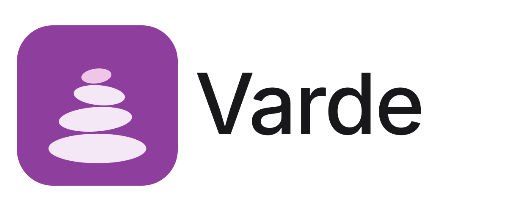

<div align="center">
  

  **A self-hosted training app with an AI running coach.**
</div>

Varde is a self-hosted fitness tracker for you and your family: activities, sleep and health data from
Garmin Connect or Strava (or uploaded `.fit`, `.gpx` and `.tcx` files), plus a coach that keeps a
14-day training plan up to date from that data.

A *varde* is the stone cairn that marks the route on a Norwegian mountain trail.

## Based on Endurain

Varde is a modified version of [Endurain](https://github.com/endurain-project/endurain), © 2023–2026
João Vitória Silva and contributors, licensed under the AGPL-3.0. Varde is not affiliated with or
endorsed by the Endurain project, and it does not use the Endurain name or logo for its own branding.
Everything Endurain does, Varde does; see the [Endurain documentation](https://docs.endurain.com) for
setup and configuration. Environment variables keep their Endurain names (`ENDURAIN_HOST`, …).

What Varde adds:

- **AI coach** (`backend/app/modules/coach`, `frontend/src/features/coach`): reads your activities,
  laps, sleep, resting heart rate, notes and goals; writes a 14-day plan, today's session, an
  assessment and goal predictions; updates after every new activity and each morning.
- **Device-neutral workouts**: every planned session carries structured steps (warm-up, repeats,
  pace/heart-rate/effort targets) ready for watch adapters.
- **Your model, your key**: each user picks the provider and model (Anthropic, or any OpenAI-compatible
  server such as OpenAI, OpenRouter, Mistral or a local Ollama) and can use their own API key, stored
  encrypted.

## Running it

```bash
cp docker-compose.yml.example docker-compose.yml
cp .env.example .env   # set passwords, keys, ENDURAIN_HOST, and optionally ANTHROPIC_API_KEY
docker compose up -d
```

The image is `ghcr.io/henr1k/varde` (`latest`, `vX.Y.Z`, `sha-<commit>`), built for amd64 by
`.github/workflows/varde-image.yml` after the backend and frontend checks pass.

## Updating from Endurain

`upstream` is Endurain. Merge `upstream/master` into a branch, open a pull request, and let CI run.
Expected conflicts: the version numbers (`API_VERSION`, `frontend/package.json`; keep Varde's) and the
brand assets. If the merge adds an upstream migration, the newest coach migration's `down_revision`
must be pointed at the new upstream head (a test fails until it is).

## License

AGPL-3.0, see [LICENSE](LICENSE). If you run a modified Varde for others, you must offer them its
source code.
